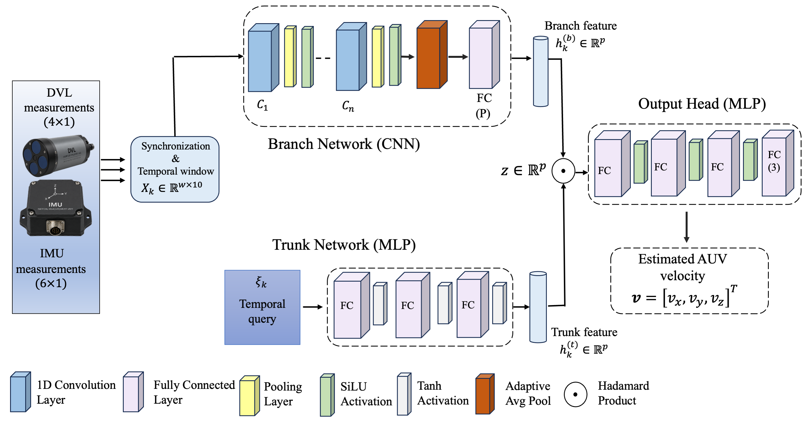

&nbsp; &nbsp;  &nbsp;  &nbsp; &nbsp;  &nbsp;  &nbsp; &nbsp;  &nbsp;  &nbsp; &nbsp;  &nbsp;  &nbsp; &nbsp;  &nbsp;  &nbsp;  


# NAViLoss: An Underwater Navigation-Aware Dual-Residual Objective for Physics-Consistent Learning

[](https://arxiv.org/abs/2610.09690)

NAViLoss is a robust, uncertainty-aware objective for learning-based
velocity estimation in autonomous underwater vehicles (AUVs).

The proposed objective jointly considers velocity-estimation error and
DVL beam-consistency error while accounting for measurement uncertainty.

NAViLoss is integrated with DeepONet to develop NAVi-DeepONet models for
robust AUV velocity estimation under noisy measurements and partial DVL
beam-outage conditions.


## Key Contributions

1. A navigation-aware dual-residual objective for physics-consistent
   velocity estimation.

2. An uncertainty-aware robust loss that reduces the influence of
   large residuals.

3. NAVi-DeepONet models for full and partial DVL beam conditions.

4. Improved velocity-estimation performance under noisy and degraded
   DVL measurements.

## NAViLoss

The proposed objective operates in two residual domains:

$$
\mathbf{r}_v = \hat{\mathbf{v}}-\mathbf{v},
$$

and

$$
\mathbf{r}_b = \mathbf{H}\hat{\mathbf{v}}-\mathbf{b}.
$$

Both residual terms use the proposed bounded robust formulation with
measurement uncertainty.


Specifically, the total NAViLoss is defined as:

$$
\mathcal{L}_{\mathrm{NAVi}}
=
\mathcal{L}_v
+
\lambda_b \mathcal{L}_b
$$

where

$$
\mathcal{L}_v
=
\frac{1}{\lambda}
\left(
1-
\frac{1}
{
1+
\lambda
\frac{\|\mathbf{r}_v\|^2}
{\sigma_v^2+\varepsilon}
}
\right)
$$

and

$$
\mathcal{L}_b
=
\frac{1}{\lambda}
\left(
1-
\frac{1}
{
1+
\lambda
\frac{\|\mathbf{r}_b\|^2}
{\sigma_b^2+\varepsilon}
}
\right)
$$


Specifically, the total NAViLoss is defined as:


$$
\mathcal{L}_{\mathrm{NAVi}}
=
\mathcal{L}_v
+
\lambda_b \mathcal{L}_b
$$

where

$$
\mathcal{L}_v
=
\frac{1}{\lambda}
\left(
1-
\frac{1}
{
1+
\lambda
\frac{\|\mathbf{r}_v\|^2}
{\sigma_v^2+\varepsilon}
}
\right)
$$

and

$$
\mathcal{L}_b
=
\frac{1}{\lambda}
\left(
1-
\frac{1}
{
1+
\lambda
\frac{\|\mathbf{r}_b\|^2}
{\sigma_b^2+\varepsilon}
}
\right)
$$

Here, $\mathcal{L}_v$ is the velocity loss, $\mathcal{L}_b$ is the
uncertainty-aware beam-consistency physics loss,
$\mathbf{r}_v \in \mathcal{R}_v$ is the velocity residual,
$\mathbf{r}_b \in \mathcal{R}_b$ is the beam-consistency residual,
$\sigma_v \in \mathcal{U}_v$ is the velocity uncertainty,
$\sigma_b \in \mathcal{U}_b$ is the beam uncertainty,
$\lambda > 0$ is the robustness parameter, and
$\lambda_b > 0$ is the beam-loss weighting coefficient.


The formulation provides:

- bounded loss values,
- quadratic behavior for small residuals,
- diminishing influence of large residuals,
- uncertainty-aware residual attenuation, and
- simultaneous velocity and DVL beam consistency.

## NAVi-DeepONet

<p align="center">
  
</p>


<p align="center">
  <em>NAVi-DeepONet architecture.</em>
</p>


## Experimental Platform

<p align="center">
  
</p>

<p align="center">
  <em>Snapir Autonomous Underwater Vehicle (AUV) used for data collection during Mediterranean Sea trials.</em>
</p>


## Results

### NAVi-DeepONet V1

| Model | VRMSE (m/s) | VMAE (m/s) | R² |
|-----------|------------:|------------:|----:|
| LS | 0.178 | 0.161 | 0.507 |
| BeamsNet | 0.116 | 0.104 | 0.706 |
| DVL-DeepONet | 0.092 | 0.074 | 0.869 |
| **NAVi-DeepONet V1** | **0.082** | **0.071** | **0.878** |


### NAVi-DeepONet V2

| Model | VRMSE (m/s) | VMAE (m/s) | R² |
|-----------|------------:|------------:|----:|
| ELC | 1.991 | 1.696 | -1.340 |
| MissBeamNet | 0.329 | 0.288 | -0.403 |
| DVL-DeepONet | 0.254 | 0.224 | 0.312 |
| **NAVi-DeepONet V2** | **0.175** | **0.142** | **0.694** |


## Files

- `main_NAViLoss.ipynb`
  - Demonstration of the proposed NAViLoss objective.

- `main_NAVi-DeepONet_V1.ipynb`
  - NAVi-DeepONet V1 for full DVL beam measurements.

- `main_NAVi-DeepONet_V2.ipynb`
  - NAVi-DeepONet V2 for partial DVL beam measurements.


## Usage

Open any notebook in Jupyter Notebook, JupyterLab, or Google Colab
and run the cells in order.


## Author

Arup Kumar Sahoo and Itzik Klein


## Citation

If you use this repository in your research, please cite:

```bibtex
@article{sahoo2026naviloss,
  title={NAViLoss: An Underwater Navigation-Aware Dual-Residual Objective
  for Physics-Consistent Learning},
  author={Sahoo, Arup Kumar and Klein, Itzik},
  journal={arXiv preprint arXiv:2610.09690},
  year={2026}
}
